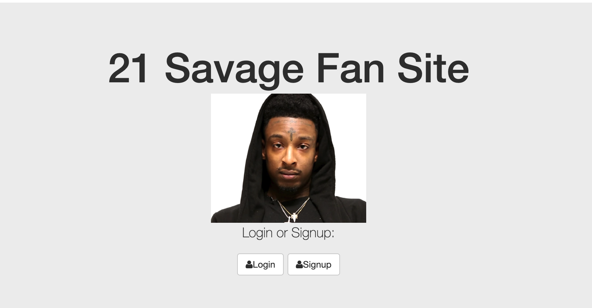
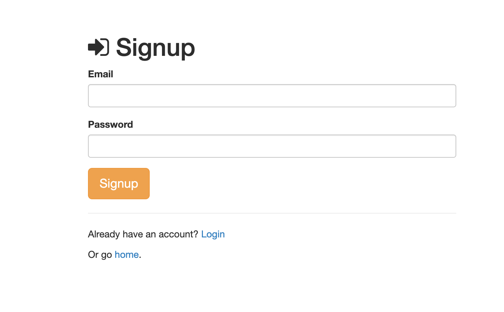
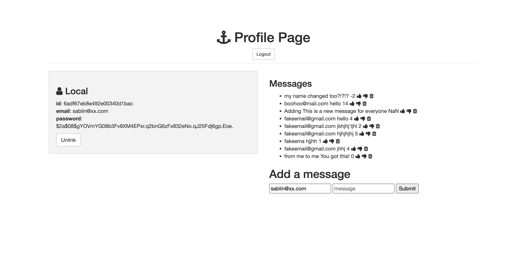

## 21 Savage Fan 

21 Savage Fan App is a full-stack web application where fans can create an account, leave comments and interact with other fans through likes and dislikes. The app uses authentication to manage user access and MongoDB to store user information and comments.

## Demo
Check out here:
Live: 
[Site](https://savage-auth-pdn2.onrender.com/)

## Features

- Website for 21 Savage Fan to leave comments
- Users can like, dislike and delete comments

## Built with

- Node.js and Express
- MongoDB with Mongoose
- EJS templates
- Plain JavaScript and CSS